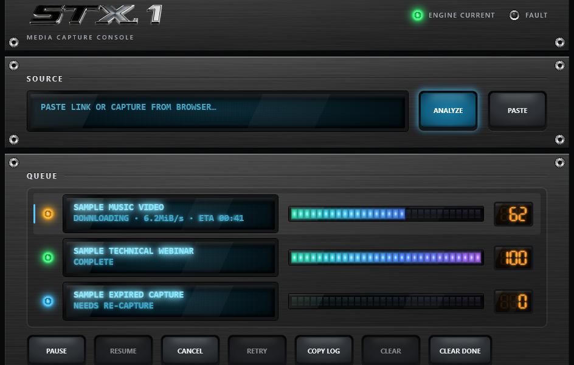
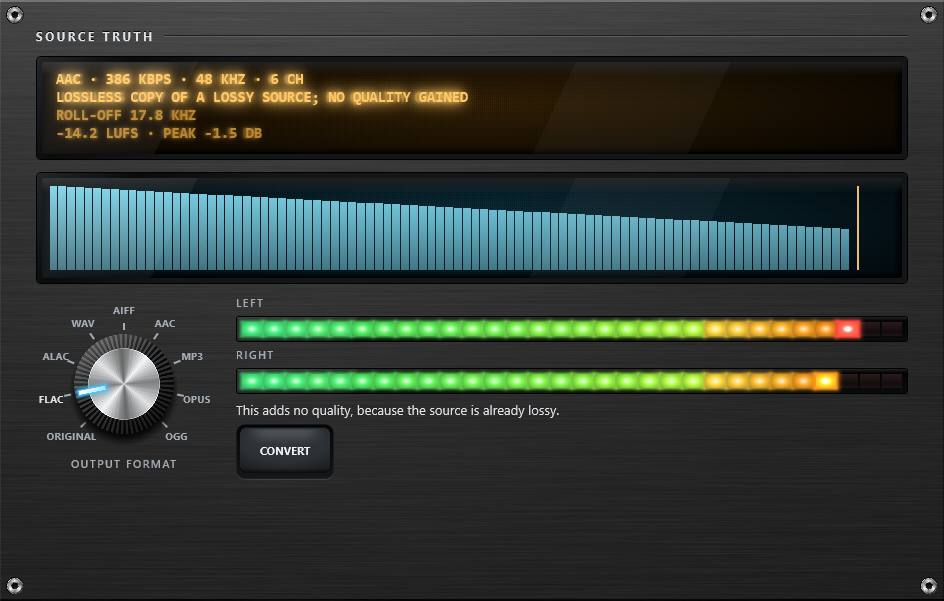
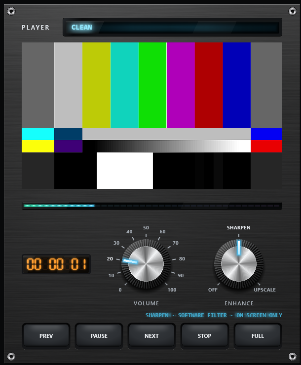
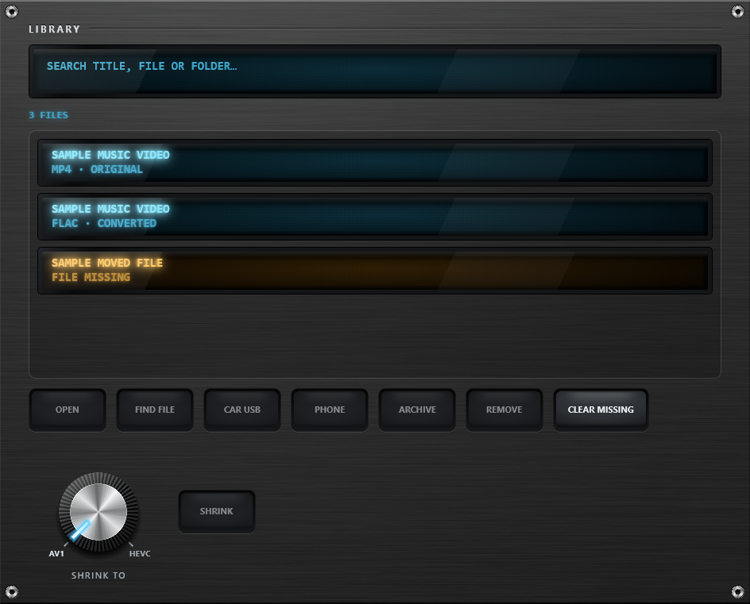
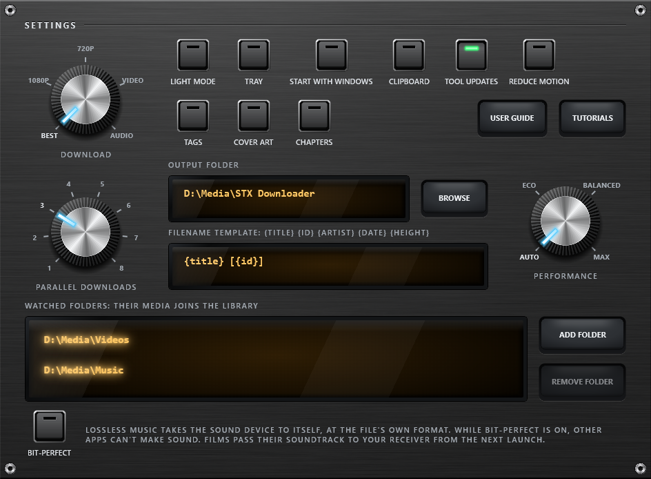
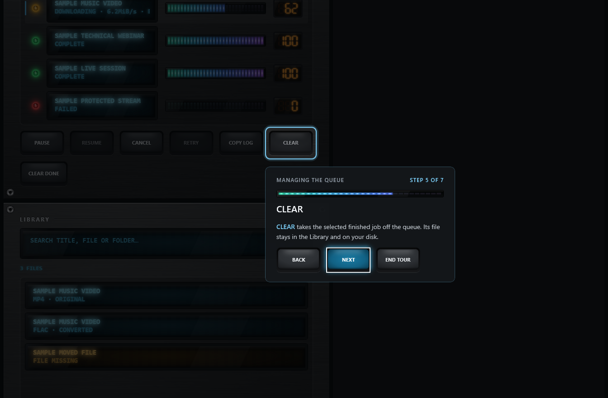

# STX Downloader

A Windows app that saves media you're allowed to keep, from YouTube and from web pages, tells you what the audio really is, and plays your whole collection with VLC's engine. It looks like a piece of solid-state rack gear, because that's the point.

**[Download 1.2.0](https://github.com/Git-Rocky-Stack/STX-Downloader/releases/tag/v1.2.0)** · [Project page](https://git-rocky-stack.github.io/STX-Downloader/) · [Changelog](CHANGELOG.md) · [MIT license](LICENSE)



> [!IMPORTANT]
> **DRM is out of scope.** STX doesn't save or play DRM-protected media. When it sees DRM, it says so and stops.
>
> **You are responsible for following each site's terms and the law where you live.**

Published by Strategia-X (Rocky Elsalaymeh). Support: support@strategia-x.com · Version 1.2.0 · [Changelog](CHANGELOG.md)

## Contents

- [Install](#install)
- [Quick start](#quick-start)
- [Screens](#screens)
- [What it does](#what-it-does): [saving](#saving), [capturing from a page](#capturing-from-a-page), [your secrets](#your-secrets), [Source Truth](#source-truth), [your whole collection](#your-whole-collection), [playing](#playing), [shrinking](#shrinking), [the console](#the-console)
- [What has and hasn't been tested](#what-has-and-hasnt-been-tested)
- [Build](#build)
- [More documentation](#more-documentation)
- [Contributing](#contributing)
- [License](#license)

## Install

| | |
|---|---|
| **Windows** | Windows 10 version 2004 or later, x64 |
| **Disk** | About 400 MB for the app, and about 430 MB for its tools, which the setup installs with it |
| **Account** | Your own: no administrator prompt |
| **Nothing else** | .NET and the Windows App SDK ship inside the app, so there's no runtime to install first (`Stx.App.csproj`, `SelfContained`) |

Download from the [1.2.0 release](https://github.com/Git-Rocky-Stack/STX-Downloader/releases/tag/v1.2.0):

| File | Size | SHA-256 |
|---|---|---|
| [`STXDownloader-1.2.0-setup.exe`](https://github.com/Git-Rocky-Stack/STX-Downloader/releases/download/v1.2.0/STXDownloader-1.2.0-setup.exe), the installer | 254 MB | 1E067230272C7223E1A9430E0B9BFF8E3ADF8C8666477CB2323C2592E7590363 |
| [`STXDownloader-1.2.0-win-x64.zip`](https://github.com/Git-Rocky-Stack/STX-Downloader/releases/download/v1.2.0/STXDownloader-1.2.0-win-x64.zip), the app alone | 171 MB | FEAF84A7A1CE1168F31DB827D637F42745886DB1AFF17DA30DFA86BAB53308F1 |

To check a download, run `Get-FileHash .\STXDownloader-1.2.0-setup.exe -Algorithm SHA256` in PowerShell and compare.

1. Run `STXDownloader-1.2.0-setup.exe`. It installs for your account only, and uninstalls from Windows Settings (`tools/installer/STXDownloader.iss`, `PrivilegesRequired=lowest`). Your saved media is never removed.
2. The setup also installs yt-dlp, FFmpeg and Deno, each checked against the checksum its publisher posts when the setup was built, so the first launch has nothing to download and works offline (`tools/Publish.ps1`). While **TOOL UPDATES** is on, STX keeps yt-dlp current by itself. The zip carries the app alone, and its first launch downloads the tools. See [third-party software](docs/THIRD_PARTY.md).

The setup and the app's own files are signed through Azure Artifact Signing. Windows shows the certificate's validated name as the publisher: Sharif Elsalaymeh.

**To capture from pages** (optional):

3. In Chrome or Edge, open the extensions page, turn on **Developer mode**, choose **Load unpacked**, and pick the `extension` folder inside the install folder. The setup's last page can open that folder for you.

The setup already registers the browser hand-off, for Chrome and Edge (`STXDownloader.iss`, `NativeMessagingHosts`).

**Or use the zip.** Unzip it anywhere, run `STXDownloader.exe`, and run `tools\Register-NativeHost.ps1` once to connect the browser. It writes to your account only, and `-Remove` undoes it.

## Quick start

The same four steps open the in-app user guide, which shows by itself on the first launch. Open it again any time from **SETTINGS**, then **USER GUIDE**. **TUTORIALS** beside it walks you through the live console, one chapter at a time.

| | Step | What to do |
|---|---|---|
| 1 | **Let it set up** | Wait for the light at the top right to turn green and read **ENGINE CURRENT**. |
| 2 | **Save a link** | Copy a video's link, then press **PASTE** on the Source plate. A playlist asks first. |
| 3 | **Watch it save** | The Queue shows each job's meter. Saves go to `Videos\STX Downloader` unless you choose another folder in Settings. |
| 4 | **Play and check it** | Select it in the Library and press **OPEN**. Source Truth shows what its audio really is. |

## Screens

Captured from 1.2.0. Each screen is drawn by the app's own panels on sample data (`tools/Capture-Gallery.ps1`, `ConsoleSample`), so no one's real files appear. The [project page](https://git-rocky-stack.github.io/STX-Downloader/#screens) has them all.

| | |
|---|---|
|  |  |
| **Source Truth** measures the audio and gives a plain verdict. | **Player**, on VLC's engine, with ENHANCE. |
|  |  |
| **Library**, your whole collection. | **Settings**, with USER GUIDE and TUTORIALS. |



## What it does

Each line names the code that does it, by file and member, so it can be checked.

### Saving

- Paste a link, and yt-dlp handles it, single items and playlists (`SourceViewModel.AnalyzeAsync`, `YtDlpArgs.ForDownload`). A playlist asks first: add its items, just the video the link names, or cancel. Private and unavailable items are skipped, and counted.
- Video isn't re-encoded by default. It keeps the original streams, in MP4 when they fit and MKV when they don't (`YtDlpArgs.ForDownload`, `Mp4Preference`).
- A name already taken by another video never replaces it or gets mistaken for it. The new file gets its id added (`YtDlpRunner`, `UniqueTemplate`).
- A new file with the same bytes as one already saved is removed, and the Library points at the first copy (`IdenticalFileCheck`, wired in `Composition`).
- CAR USB, PHONE and ARCHIVE convert a saved file when you ask (`PresetCatalog.All`).
- A captured job whose link expired waits for a new capture from its page, and resumes from it (`QueueEngine.Recapture`, `CaptureHandler.Resume`).

### Capturing from a page

- A Chrome and Edge extension lists the page's HLS, DASH and direct media (`extension/worker.js`, `readMaster`), collapses renditions, and hands over YouTube embeds by ID (`extension/detect.js`, `findEmbeds`).
- Rows are labeled with whatever the page exposes: name, length, resolution (`detect.js`, `labelFor`). A YouTube row offers **Save**, and **Save signed in**, which sends your YouTube cookies with that one item (`extension/popup.js`, `row`).
- If the page uses DRM, its streams get no Save button (`detect.js`, `canDownload`).
- Hand-off uses Chrome native messaging and a named pipe only your Windows account can open. No network port is opened (`PipeServer.CreatePipe`).

### Your secrets

- Stream tokens, cookies and headers stay in memory (`CaptureVault`) and reach yt-dlp through a temp file only you can read, deleted when the job ends, or at the next launch if something held it (`CredentialFile.Create`, `CredentialFile.Dispose`, `CredentialFile.DeleteLeftovers`).
- They are scrubbed from the log you can copy (`Redactor`).

### Source Truth

- Measures the saved file's audio rather than repeating what the site claims (`AudioMeasurer`), and shows the spectrum, the roll-off, loudness and true peak (`SourceTruthPanel`, `SourceTruthViewModel.RollOffLine`).
- Gives a plain verdict for each output format, and never says re-encoding improved anything (`Verdict.For`).

### Your whole collection

- The Library holds everything: what you've saved, files you've opened with STX, and the media in your Videos and Music folders, which are watched from the first launch (`AppSettings.DefaultWatched`). ADD FOLDER and REMOVE FOLDER in Settings change the list. Removing a folder takes its files out of the Library, never off your disk (`SettingsPanel.WatchedFolders`, `MediaRepo.ForgetWatchedUnder`).
- The first scan runs in the background, below normal priority, and rows appear as it goes (`CollectionWatcher.Watch`). After that, new files appear by themselves, a renamed or moved file keeps its row, and a deleted one stays listed as FILE MISSING until you clear it (`CollectionWatcher.ApplyPending`, `FolderScan.Plan`).
- Watched files are indexed lightly: path, size and date, so a OneDrive file that lives only online isn't downloaded by being listed. A file's bytes are hashed the first time you choose it (`Composition.HashOnFirstUseAsync`).
- Each row says ORIGINAL, OPENED or WATCHED (`LibraryRowViewModel`). Search looks through title, file name and folder, and every word you type has to match (`LibrarySearch.Matches`).
- REMOVE takes the selected row off the Library, and CLEAR MISSING every row whose file is gone, scrolled to or not. Only rows go, never a file on disk; a row with a job still in the Queue stays until the job ends, and a file still in a watched folder leaves with its folder (`LibraryViewModel.RemoveAsync`, `LibraryViewModel.ClearMissingAsync`, `MediaRepo.Forget`).
- The Library's list sits in a tray that grows with its plate, and the plate always meets Source Truth's bottom edge, so the console reads as one block with no dead space, full or empty (`DeckPanel`, `ListWell`).
- The database counts, pages and searches the rows, so the Library holds only what's on screen: 50,000 rows cost no more memory than an empty Library (`ILibraryCatalog`, `LibraryViewModel.Page`, [performance](docs/PERFORMANCE.md)).

### Playing

- STX plays media with VLC's engine: the official VLC 3.0.24 build for Windows, pinned by sha256 (`tools/vlc/engine.json`). The parts that would open network ports or run site scripts are left out (`engine.json`, `LibVlcOptions.For`).
- A PLAYER plate sits beside the Library, above Source Truth (`MainWindow`). OPEN in the Library plays the file there and never hands it to another app (`LibraryViewModel.OpenCommand`, `Composition.Play`).
- A file opened from File Explorer joins the Library and plays (`App.OnLaunched`, `Composition.OpenFromOutsideAsync`). A second launch with a file hands it to the copy already running, over a named pipe only your account can open (`SingleInstance.TryBecomeFirst`, `OpenRequests`).
- PREV and NEXT walk the Library in its order, past files gone from disk (`LibraryViewModel.PlayOrder`, `PlayerViewModel`). AUDIO, SUBTITLES and CHAPTER knobs appear when a file has more than one (`PlayerPanel.Picker`).
- The plate fits the rack's right column at any width: when the time, VOLUME and the other knobs don't fit on one line, the other knobs wrap under it, and ENHANCE's readout has a line of its own that wraps too, so nothing is pushed off the plate (`KnobRowLayout.Arrange`, `KnobRow`).
- FULL, or a double-click on the picture, fills the screen; EXIT or Esc brings the console back. The video keeps playing through it (`PlayerPanel.SetFullScreen`).
- Hidden in the tray, the player stops decoding pictures and the sound carries on (`LibVlcEngine.HideVideo`).
- A PERFORMANCE knob in Settings sets how hard playback may work: AUTO picks from the PC, or choose ECO, BALANCED or MAX (`PerformanceProfile.For`).
- MIDI plays, using the FluidR3_GM SoundFont that ships with the app (`LibVlcEngine.ShippedSoundFont`).
- **Dirac and VC-2 video are refused.** VLC 3.0.24's engine crashes on them, the desktop VLC build included. Rather than let STX close, it shows "DIRAC VIDEO CAN'T BE PLAYED SAFELY", for files and for http(s) streams alike (`LibVlcEngine.DiracRefused`, `DiracSniff.InStreamAsync`).
- **STX as your default player.** The setup registers STX, for your account only, for every type the parity corpus proves it plays (`tools/installer/associations.iss`, `FileAssociations.Plan`, `MediaTypes`). The first time, STX asks once whether it should be your player. YES opens Windows' Default Apps, where you choose it; Windows doesn't let an app choose itself (`DefaultPlayerViewModel.ShowOffer`). DEFAULT PLAYER in Settings opens that page any time. Its readout counts the types STX plays and, after DEFAULT FOR, how many Windows already opens with STX, such as PLAYS 120 TYPES · DEFAULT FOR 6, and its light is green for every type, amber for some (`SettingsPanel.DefaultPlayer`, `FileAssociations.Read`, `DefaultState.Text`). It used to read STX OPENS 6 OF 51 TYPES, which sounded like a limit on what STX can play; it never was. STX plays 120 types, each proven by a corpus file, and the user guide lists them all (`MediaTypes`, `GuideContent.Formats`).
- **Discs.** PLAY DISC plays an unencrypted DVD or Blu-ray from its drive, its folder or an image, from the main title (`Composition.PlayDisc`, `LibVlcOptions.ForTarget`). **Encrypted discs are refused by STX itself before VLC's engine sees them**: it reads the CSS scrambling bits in a DVD's sectors, and a Blu-ray's AACS folder and copy-permission bits, and says THIS DISC IS ENCRYPTED, SO IT CAN'T BE PLAYED. A sector it can't read counts as encrypted (`DiscCheck.Inspect`, `DiscCheck.IsScrambledSector`, `DiscCheck.BluRayFolder`). VLC's DVD plugins contain libdvdcss, which can decrypt CSS; STX never hands them an encrypted disc.
- **Streams and internet radio.** PLAY STREAM plays a stream address, a radio station, or its .pls or .m3u playlist. A web page is sent to ANALYZE and the capture path instead (`StreamOpener.ResolveAsync`, `PlaybackTarget`). VLC's engine only connects out: UDP and RTP would need a listening port, so they're refused, and RTSP runs over its one TCP connection (`PlaybackTarget`, `LinkKind.Refused`).
- **BIT-PERFECT**, a Settings switch, off by default (`SettingsPanel.BitPerfectRow`). Lossless music is decoded by FFmpeg and sent to your sound device, which STX holds exclusively at the file's own rate and depth. Nothing resamples, mixes, dithers or changes the volume (`BitPerfect.Route`, `BitPerfect.Candidates`, `BitPerfect.FfmpegArgs`, `ExclusiveRenderer`). A film's AC3, E-AC3, DTS or TrueHD soundtrack goes to your receiver as it is, from the next launch (`LibVlcOptions.For`, `passthrough`). The Player shows what reaches the device, such as 24/96 BIT-PERFECT, or why a file plays shared (`RoutingEngine.AudioReadout`). While it's on, other apps can't make sound, and VOLUME is fixed (`PlayerPanel.Render`). VLC 3.0.24's own audio output can't do this; [docs/PLAYBACK.md](docs/PLAYBACK.md) says why.
- **ENHANCE** on the Player: OFF, SHARPEN or UPSCALE, for the picture on screen only (`PlayerPanel.EnhanceDial`, `Enhance.Options`). UPSCALE is GPU super resolution, offered only where the GPU has it: NVIDIA RTX with a 530 or later driver, and Intel Arc or Xe. Anywhere else it says UPSCALE UNAVAILABLE rather than pretend (`Enhance.SuperResolution`, `HardwareProbe`). PERFORMANCE sets how far it may go (`Enhance.Effective`). Under the knob, the Player says what VLC's engine confirms is running (`LibVlcEngine.EnhanceSeen`, `Enhance.Status`).
- Parity with VLC is tested. VideoLAN's feature list for 3.0.24 is written down (`tests/corpus/vlc-features.json`), and a corpus of 178 files plays through STX's engine (`tests/corpus/manifest.json`, `CorpusTests`). It covers 89 of the 91 formats and codecs on the list, plus four modern profiles: HEVC Main10, HDR10, AV1 and VP9. The two that can't be tested are SVCD/CVD subtitles, for which no public sample exists, and CMML, which LibVLC 3.0.24 has no decoder for. Details are in [docs/PLAYBACK.md](docs/PLAYBACK.md).

### Shrinking

- SHRINK makes a smaller copy beside the selected file: AV1 or HEVC video with Opus sound, as the Shrink to knob says, or Opus for sound alone. Subtitles, chapters and attachments come along (`PresetCatalog.All`, `FfmpegArgs.Encoder`). SHRINK FOLDER does the same for every file in a folder, as jobs in the Queue (`ShrinkFolder.QueueAsync`).
- A copy is kept only after it checks out: it decodes from start to end without errors, has the original's picture and sound, and lasts as long. A copy that fails is deleted and the job says so (`CopyCheck.ProblemAsync`, `FfmpegRunner`). The original is only ever read.
- The settings were checked with VMAF on real footage: AV1 at CRF 30 and HEVC at CRF 24 keep live action at VMAF 95 to 97 ([performance](docs/PERFORMANCE.md)).
- Source Truth calls a shrink copy lossy, never improved. Each copy says how much smaller it is, and the Library adds up what deleting the originals would free. STX never deletes them (`LibraryRowViewModel.Status`, `LibraryViewModel.SpaceText`).

### The console

- Black anodized by default, brushed aluminum as light mode (`SettingsPanel`, `LookTokens`). Text meets WCAG AA contrast on both plates (`FaceplateLogicTests`).
- Sharp at any display scale: STX is per-monitor DPI aware (`src/Stx.App/app.manifest`, `WindowSize.Set`).
- Choose best quality, up to 1080p or 720p, video only or audio only, and which metadata to embed (`SettingsPanel`, `DownloadChoices.Map`).
- Tray mode (`Tray`), start with Windows (`StartupRegistry`) and an optional clipboard offer, off by default (`ClipboardWatcher`).
- The Queue keeps its history across launches, and clears it when you say: CLEAR takes the selected finished job off, CLEAR DONE every complete, canceled or failed one. What they saved stays in the Library and on disk (`QueueEngine.Remove`, `QueueEngine.RemoveFinished`).
- Meters that read like hi-fi gear: a job's progress sweeps aqua through cyan and azure to violet, and the LEFT and RIGHT level meters shade green through lime, yellow and orange to red, inside the same 72% and 90% zones as before (`BargraphLogic.ZoneHex`, `LedArt.SegmentLit`).
- A USER GUIDE pad and a TUTORIALS pad on the Settings plate (`SettingsPanel.HelpPad`). The guide opens by itself on the first launch, once (`SettingsViewModel.TakeFirstLaunchGuide`). It starts with four quick-start steps, then an index of sections beside one page at a time, with PREVIOUS and NEXT, the controls each section names, and SHOW ME to run its tutorial. It sets every pad, switch and knob it names in the console's accent; a test fails if the guide names a control the console doesn't have, or the console has one the guide never names (`GuidePanel`, `GuideContent`, `GuideTests`). Its "What STX plays" section lists every type from the registered list itself, so it can't drift (`GuideContent.Formats`).
- **Tutorials** are seven guided chapters on the live console, from your first save to the advanced settings, not a recording. START dims the window and walks a spotlight over each real control, scrolling it into view, with a card beside it; the lit control still works, so you can try it. NEXT, BACK, FINISH, END TOUR and Esc drive it, and a finished chapter's lamp stays green (`TutorialPanel`, `TourOverlay`, `TutorialContent`, `TourTargets`). With reduce motion on, the spotlight moves without gliding. Tests hold every step's words, controls and target to the console, as the guide's are (`GuideTests`).
- The first run waits out a tool host that's briefly down, asking again after 2, 5 and 10 seconds (`ToolManager.TransientWaits`). If setup still can't finish, a Setup plate says why and offers RETRY (`FirstRunViewModel`).

## What has and hasn't been tested

[Real-site results](docs/REAL-SITE-CHECKS.md) and [performance numbers](docs/PERFORMANCE.md) are written down, including what wasn't tested: a registered webinar, a playlist with a private entry, more than one commercial DRM page, and a real unplugged network.

The player was built in phases, and each phase's report says what was proven on hardware: [Phase 1](docs/superpowers/reports/2026-11-04-player-phase1-report.md), [Phases 2 to 7](docs/superpowers/reports/2026-11-05-player-phases-2-7-report.md), and the [2026-11-07 review](docs/superpowers/reports/2026-11-07-review-report.md). Since then, on a Core Ultra 7 258V laptop (Arc 140V, a 2880x1800 panel at 175%, HDR on):

- **Proven:** BIT-PERFECT at 44.1 and 96 kHz on a real sound device; UPSCALE running on the Arc's super resolution; a high-DPI screen; HDR10 reaching an HDR screen as HDR; Default Apps as Windows past 24H2 reads them.
- **Not yet:** the reference PC's runs of the 50,000-row memory budget, the screenshot gate and the corpus gate; a bit comparison through a hardware loopback; a USB DAC unplugged mid-play; real DVD and Blu-ray discs; film passthrough to a receiver; an RTX GPU; and a clean machine for the installer.
- **Known:** 4K60 on the laptop's panel loses 3 to 4 pictures a second in about half of the runs. What limits it is VLC 3.0.24's Direct3D 11 output, not decoding ([performance](docs/PERFORMANCE.md)).

## Build

Needs the .NET 10 SDK, Node 24 for the extension's tests, and PowerShell 7. The first build downloads VLC's engine and the SoundFont, pinned by sha256 (`tools/vlc/Get-Engine.ps1`).

```
dotnet build src/Stx.App -c Release -p:Platform=x64
dotnet test --project tests/Stx.Core.Tests
node --test "extension/test/*.test.js"
tools\Publish.ps1        # the zip and the installer; add -Sign to sign
```

`Publish.ps1` takes the version from `Directory.Build.props`, and needs [Inno Setup 6](https://jrsoftware.org/isdl.php), installed for everyone or just for you. Signing needs an `az login` that may use the Strategia-X signing account.

## More documentation

| Document | What's in it |
|---|---|
| [CHANGELOG.md](CHANGELOG.md) | Every release, and every change in it |
| [docs/PLAYBACK.md](docs/PLAYBACK.md) | The player: the engine, what it refuses and why, BIT-PERFECT, the parity corpus |
| [docs/PERFORMANCE.md](docs/PERFORMANCE.md) | Memory, CPU and playback measurements, and Shrink's quality checks |
| [docs/REAL-SITE-CHECKS.md](docs/REAL-SITE-CHECKS.md) | Saving from real sites, as checked on 2026-11-01 |
| [docs/THIRD_PARTY.md](docs/THIRD_PARTY.md) | What ships inside the app, what it downloads, and their licenses |
| [Project page](https://git-rocky-stack.github.io/STX-Downloader/) | Screens, downloads and release history, published from `site/` by `.github/workflows/pages.yml` |

## Contributing

Issues and pull requests are welcome on [GitHub](https://github.com/Git-Rocky-Stack/STX-Downloader/issues). CI builds and tests every push (`.github/workflows/build.yml`). The screenshot, Device and Corpus tests need a real PC and run locally, as the workflow's comments say. Signing a build (`tools\Publish.ps1 -Sign`) needs the publisher's Azure signing account, so builds made from a fork are unsigned. For security issues, write to support@strategia-x.com rather than opening a public issue.

## License

[MIT](LICENSE). Copyright (c) 2026 Rocky Elsalaymeh, Strategia-X. Third-party software, the parts shipped inside the app and the tools it downloads, keeps its own license; see [third-party software](docs/THIRD_PARTY.md).
